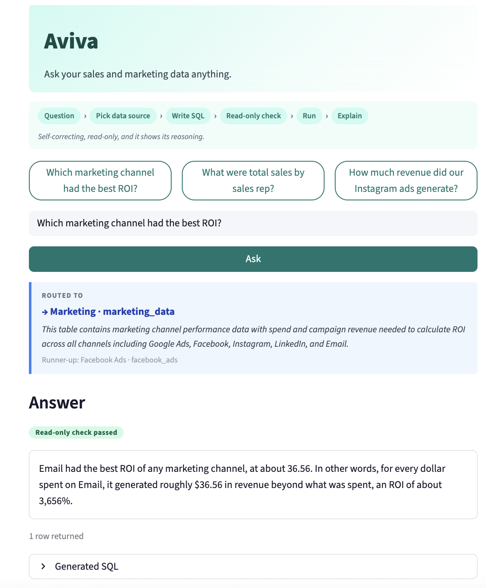
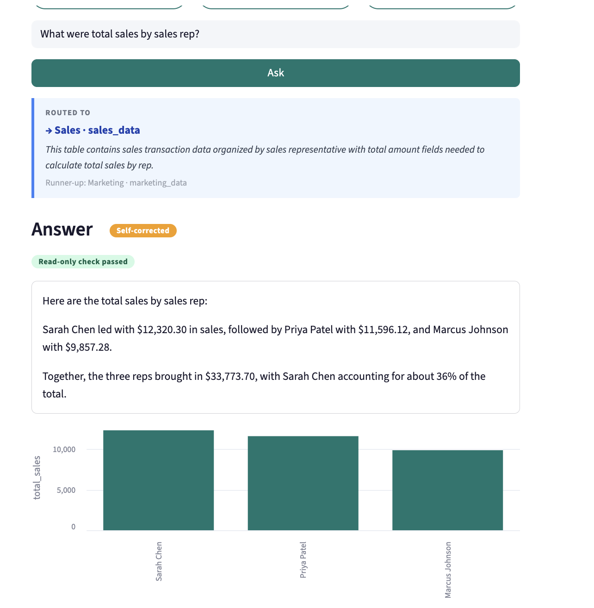
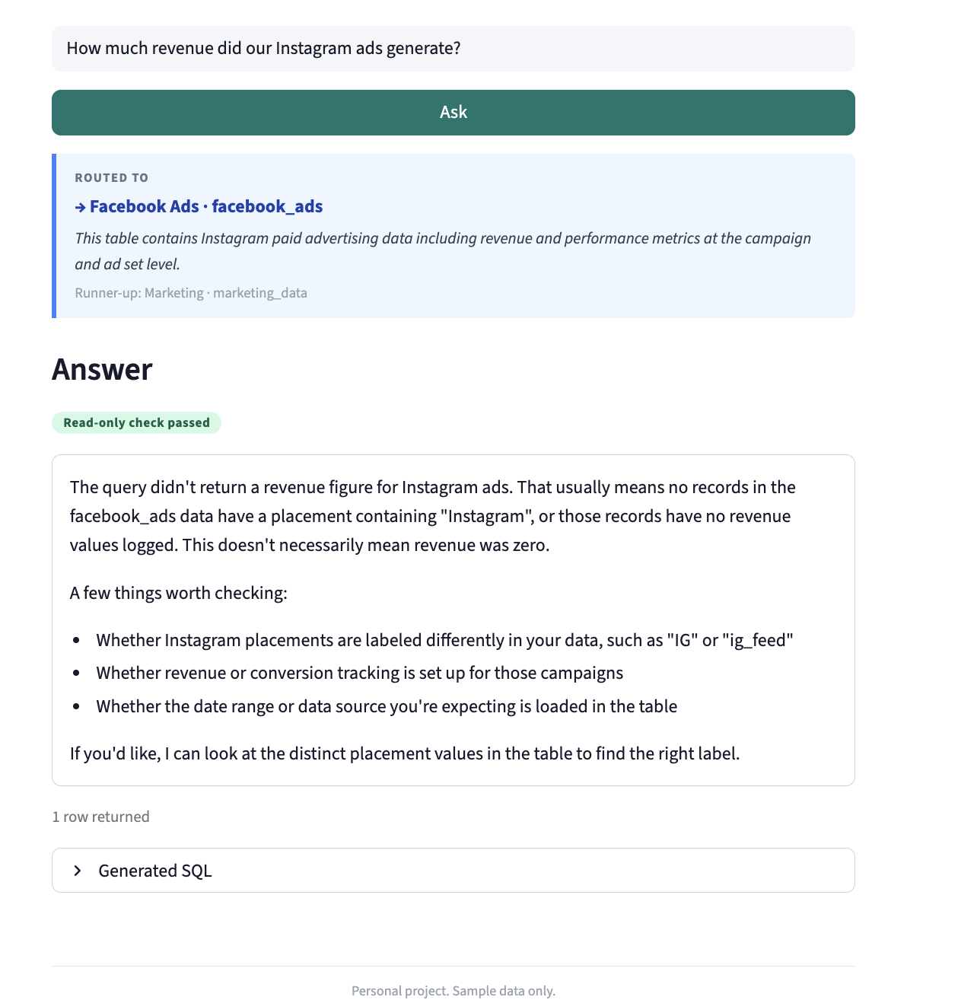

# Aviva

Natural language analytics: ask a business question, get an answer backed by SQL.



## What it does

Type a question in plain English. Aviva picks the right data source from a set of configured
tables, writes a PostgreSQL query, runs it against a Supabase database, and explains the
result in plain language. The generated SQL and source-selection reasoning are visible in
the UI.

## How it works

Each question goes through the following steps in `pipeline.answer_question()`:

1. **Route:** `claude-haiku-4-5-20251001` reads the plain-English description of every
   configured data source in `config.py` and returns a JSON object: the chosen table, a
   one-sentence reason, and the runner-up source. No vector index; no similarity scores; one
   LLM call per question.

2. **Schema fetch:** `information_schema.columns` is queried for the chosen table.
   Column names and types are injected directly into the next prompt.

3. **SQL generation:** `claude-sonnet-5-5` receives the question and schema and returns a
   single PostgreSQL query. If Claude wraps the query in a code fence, the fence is stripped
   before any further processing.

4. **Read-only guard:** `sql_guard.check_sql()` inspects the generated query before
   it touches the database. See "Safe by design" below.

5. **Execution:** SQLAlchemy runs the query against Supabase Postgres inside a
   read-only transaction.

6. **Self-correction:** If execution raises an exception, `claude-sonnet-5-5` receives
   the question, schema, failing SQL, and the raw database error and returns a corrected
   query. The corrected query goes through the guard again before execution. See
   "Self-correcting" below.

7. **Answer:** `claude-sonnet-5-5` formats the result rows into a plain-English answer.

The routing decision (chosen table, reason, runner-up) appears above the answer in the UI.
A "Self-corrected" badge marks answers that required the retry step.

## Safe by design

Every generated query, including queries produced by the self-correction step, passes
through `sql_guard.check_sql()` before execution.

**What the guard allows:** a single `SELECT` or `WITH ... SELECT` statement. Comments are
stripped and the contents of string literals and quoted identifiers are masked before any
check, so a value like `WHERE name = 'Drop; Delete Inc'` is correctly allowed.

**What the guard blocks:**
- Any statement that does not start with `SELECT` or `WITH`
- Multiple statements (a semicolon after the first statement)
- Dollar-quoted strings (`$$`)
- The keywords `INSERT`, `UPDATE`, `DELETE`, `DROP`, `ALTER`, `TRUNCATE`, `CREATE`, `GRANT`
- The keyword `INTO`, which Postgres uses in `SELECT ... INTO t` to create a table

A blocked query is a hard stop. It is never retried, never executed, and produces a fixed
user-facing message. The raw SQL and block reason are logged.

**Second independent layer:** `execute_sql()` opens the connection with
`SET TRANSACTION READ ONLY` before running any query. The guard and the transaction setting
are independent: the guard catches problems at parse time; the transaction setting means
the database itself refuses any write that somehow cleared the guard.

## Self-correcting

When execution fails, the pipeline makes exactly one recovery attempt:

1. The database error (driver text only, no internal stack trace) is sent to
   `claude-sonnet-5-5` alongside the original question, schema, and failing SQL.
2. The corrected SQL passes through the same read-only guard.
3. If the corrected query also fails, the pipeline stops and returns a friendly message.
   There is no second retry.

The UI marks recovered answers with a "Self-corrected" badge and exposes an expander
showing the original failing query, the database error, and the corrected query.

A demo toggle in the sidebar deliberately misspells one column name in the first generated
query (swaps its last two letters, e.g. `total_amount` becomes `total_amoutn`) so the
self-correction path runs live during a demo.


*The self-correction expander showing the failing query, the database error, and the corrected query.*

## What it taught me

**The Instagram misroute**



When asked "How much revenue did our Instagram ads generate?", the router consistently
selected `facebook_ads` instead of `marketing_data`.

The `facebook_ads` description opened with "Facebook and Instagram paid advertising data"
and its routing hints explicitly listed "Instagram ads" as a use case. The `marketing_data`
description only mentioned Instagram in passing: "channel (Google Ads, Facebook, Instagram,
LinkedIn, Email)". The model followed the descriptions accurately.

The problem was that the `facebook_ads` description promised data the table did not have.
The table tracks Facebook ad placements (Feed, Stories, Reels, Audience Network) and
has no per-channel Instagram breakdown. The correct answer, $77,000 from
`marketing_data` where `channel = 'Instagram'`, came from the runner-up table,
which was `marketing_data` every time.

The fix is a data-catalog fix, not a model fix: either remove "Instagram ads" from the
`facebook_ads` description or add a note that the table does not separate Instagram from
Facebook and that `marketing_data` is the source for Instagram channel totals.

The lesson: in a natural-language analytics system, routing is only as good as the written
descriptions of the data. A description that overpromises produces confident wrong answers.
The description is left uncorrected in this repo so the failure can be reproduced.

## Testing

```bash
python tests/test_sql_guard.py
python tests/test_retry.py
```

Latest run (October 2026): **4 / 4** passing in `test_sql_guard.py`,
**7 / 7** passing in `test_retry.py`. All tests use mocks; no API key or database required.

`test_sql_guard.py` covers:
- 16 queries that must be blocked, including keywords hidden inside comments,
  multi-statement injections, and a CTE that wraps a DELETE
- 6 queries that must pass, including keywords inside string literals and quoted identifiers
- An integration test that forces the pipeline to "generate" a DROP statement and verifies
  that `execute_sql` is never called
- A live check that Postgres itself rejects writes inside a read-only transaction
  (skipped if `DATABASE_URL` is not set)

`test_retry.py` covers the full retry state machine: clean first run with no retry;
one-retry recovery; blocked first query with no retry; blocked corrected query as a hard
stop; double failure returning a friendly message with no internal trace; unexpected error
returning a friendly message; and code-fence stripping.

## Run locally

Requires Python 3.11+, a Supabase project (free tier works), and an Anthropic API key.

```bash
git clone https://github.com/KrishDamania21-source/aviva.git
cd aviva
python -m venv venv
source venv/bin/activate
pip install -r requirements.txt
```

Copy `.env.example` to `.env` and fill in both values:

```bash
cp .env.example .env
```

```
ANTHROPIC_API_KEY=sk-ant-...
DATABASE_URL=postgresql://postgres.<project-ref>:<password>@aws-0-<region>.pooler.supabase.com:5432/postgres
```

Load the four sample CSVs into your Supabase database:

```bash
python loader.py
```

Launch the app:

```bash
streamlit run app.py
```

Opens at `http://localhost:8501`.

## Also in this repo

**Tableau extension** (`extension/`): an HTML/JavaScript Tableau dashboard extension.
When loaded into a Tableau workbook it lets users type questions in a panel, pushes worksheet
snapshots to the FastAPI backend as a DuckDB in-memory session, runs SQL against that
session, and applies filter instructions returned by the pipeline back to the dashboard.
The backend API was tested locally; the extension has not been tested against a live workbook recently.

**FastAPI backend** (`api.py`): a thin HTTP wrapper around `pipeline.answer_question()`.
Endpoints: `POST /query`, `POST /load-session`, `GET /connections`, `POST /refresh`. The
backend supports three execution modes: Supabase Postgres (default), a DuckDB session
loaded from the extension, and an n8n credential broker for routing queries to external
databases using credentials stored in n8n's vault. The n8n broker mode is a placeholder;
the webhook is not deployed.

## Roadmap

- Automated evaluation harness: a question bank with labeled correct sources and expected
  answers, used to score routing accuracy and answer correctness automatically across
  model or description changes
- Conversation memory: retain prior turns so follow-up questions can reference earlier results
- Multi-source questions: allow the pipeline to join or compare data across tables
- Reviving the Tableau extension: rebuild against a stable Supabase project, fix the
  hardcoded filter-field names, and redeploy on Netlify and Render

## Disclaimer

Personal project. All data sources are synthetic samples generated for this project; they
do not represent any real company, product, or dataset.

## Built with

- LLM: Anthropic Claude. `claude-haiku-4-5-20251001` for routing;
  `claude-sonnet-5-5` for SQL generation, self-correction, and answer formatting
- Database: Supabase Postgres via SQLAlchemy + psycopg2
- In-memory sessions: DuckDB (Tableau extension path)
- Frontend: Streamlit
- HTTP API: FastAPI + uvicorn
- Data loading: pandas
